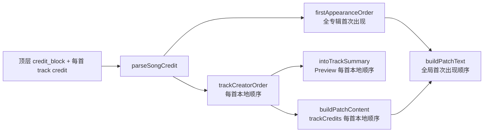

## 需求概述

修复工具端 Credits 的**成员显示顺序**，让以下三处都按用户在工具编辑器里写的顺序显示，而不是按全专辑首次出现顺序：

- 曲目预览（Preview，每首曲目单独）
- `patch_content.trackCredits`（每首曲目单独）
- `patchText`（全局 `角色：名字(曲目)、...` 文本）

## 核心行为

- 多首曲目输入时，每首曲目的成员顺序跟随**该曲目自己的 credit 行**：例如第 54 首的艺术家顺序是 `HJLL、S9ryne、VeetaCrush、勇仕音频、Polymath9、Vanguard Sound、深空之眼、Dash Sound`，作曲/编曲同理。
- `patchText` 是全局单份文本，按「首次出现顺序」排列：顶层 credit_block 优先，然后按曲目顺序；同一名字/职位保留第一次出现的位置。
- 分隔符保持 `、`，不改；角色行顺序保持现有 `defaultRoleOrder` / `orderedEntries`，不改。
- 不改 Infobox（`intoRoleSummary`）、Gallery、`relaData`、`trackInfoWriter` 的既有行为。
- 单首曲目输入的输出不应发生可见变化（本地顺序即全局顺序）。
- 预览和 patch 最终都应呈现用户写入时的成员顺序，而不是被前面的曲目「带偏」。

## 技术栈

- 现有 SvelteKit + TypeScript 项目，无新增运行时依赖。
- 验证使用现有 Vite SSR 方式，临时脚本放在 `script/` 下，验证后删除；不改测试框架。

## 根因

`Release.credits` 是**全专辑合并后的全局对象**：

- `fromRawRelease` 先用顶层 `raw.credits` 初始化，再按曲目顺序把每首 `trackCredits` 合并进去；相同名字只保留第一次插入位置。
- `intoTrackSummary` 遍历全局 `this.credits`，按 `pd.parts` 把 creator push 到每首曲目的数组，所以每首曲目的成员顺序 = 全局首次出现顺序。
- `patchExport.buildPatchContent` 按 `kept` 的全局顺序把 item push 到 `trackCredits[trackKey][roleKey]`，同样不是该曲目本地顺序。
- `buildPatchText` 按 `kept` 的全局顺序输出，多首曲目时同一职位的名字会按首次出现顺序排列。

## 实现策略

新增一个纯逻辑模块记录顺序，不改 `credits` 的数据形态：

1. **顺序模型**（`src/routes/creditOrder.ts`，新建）

- `CreditRef { roleID: string; name: string }`
- `TrackCreatorOrder = Map<string, CreditRef[]>`，key 为 `"disc.track"`（从 1 开始），value 为该曲目 credit 行里的 `(roleID, name)` 顺序。
- `sortByCreditOrder(items, getName, refs)`：按 `refs` 中首次出现的 name 稳定排序；refs 中没有的 name 保持原相对顺序，排在已出现的 name 之后。
- 不依赖 `postprocess` / `patchExport`，避免循环 import。

2. **记录顺序**（`postprocess.ts`）

- `Release` 增加两个公开字段：
    - `trackCreatorOrder: TrackCreatorOrder = new Map()`
    - `firstAppearanceOrder: CreditRef[] = []`
- `fromRawRelease`：
    - 顶层 `raw.credits` 解析后，把 `(roleID, name)` 按解析顺序写入 `firstAppearanceOrder`。
    - 每首 `trackCredits` 解析后：
    - 生成该曲目的 `CreditRef[]`（`Object.entries(trackCredits)` 的顺序，即该曲目 credit 行顺序），写入 `trackCreatorOrder`；
    - 把首次出现的 `(roleID, name)` 追加到 `firstAppearanceOrder`；
    - 再执行现有的全局 `credits` 合并。
    - `shouldAutofillArrangment` 补出的编曲者不在曲目行里：追加到 `firstAppearanceOrder` 末尾；`trackCreatorOrder` 里没有它们，后续排序自然排在本地名字之后。
    - 构造 `Release` 后把两个字段赋值。
- 直接 `new Release(...)`（测试/其他调用）不传顺序时字段为空，排序回退到现有全局顺序，保证向后兼容。

3. **Preview 顺序**（`postprocess.ts` 的 `intoTrackSummary`）

- 构建 `r` 后，对每首曲目/每个 roleID：
    - 从 `trackCreatorOrder.get("disc.track")` 过滤出该 roleID 的 refs；
    - 用 `sortByCreditOrder` 对该数组稳定排序。
- `r0`（`parts.length === 0` 的条目级信息）不动，保持顶层填写顺序。
- `Preview.svelte` 不需要修改，它消费 `intoTrackSummary` 的结果。

4. **trackCredits 顺序**（`patchExport.buildPatchContent`）

- 桶从 `StaffPatchItem[]` 改为临时 `{ name, item }[]`，保留现有 `JSON.stringify` 去重。
- 构建结束后，对每个 `trackKey` / `roleKey`：
    - 取该曲目的 `CreditRef[]`；
    - 用 `splitRoleLabel(ref.roleID).key` 把原始 roleID 映射到 patch 的 `roleKey`（例如 `作曲-主题作曲` → `composer`，`乐器-小提琴` → `instrument`，`custom-制作` → `custom-制作`）；
    - 过滤出同 `roleKey` 的 refs，按 name 稳定排序，再映射为 item。
- `epinfo`（`parts` 为空）同样按 `firstAppearanceOrder` 中对应 roleKey 的首次出现顺序排序，保持与 `patchText` 一致。

5. **patchText 顺序**（`patchExport.buildPatchText`）

- `bucket` 的 `nameMap` 在 `pushRole` 时按 `release.firstAppearanceOrder` 中该 roleID 的首次出现顺序排序，再输出。
- 角色行顺序仍由 `orderedEntries` 决定；名字之间仍用 `、` 连接。
- 规则明确：多首曲目同一职位顺序不同时，`patchText` 只能采用**全专辑首次出现顺序**（顶层 credit_block → 曲目顺序）；每首曲目的本地顺序由 Preview 和 `trackCredits` 保证。

## 架构与数据流



## 目录结构

```
src/routes/
├── creditOrder.ts        # [NEW] CreditRef / TrackCreatorOrder / sortByCreditOrder
├── postprocess.ts        # [MODIFY] Release 字段、fromRawRelease 记录顺序、intoTrackSummary 排序
├── patchExport.ts        # [MODIFY] buildPatchContent 每首排序、buildPatchText 首次出现排序
└── Preview.svelte        # [NO CHANGE] 消费 intoTrackSummary

script/
└── tmp-order-check.mjs   # [TEMP, NEW] 临时验证脚本，验证后删除
```

## 关键代码结构

```ts
// src/routes/creditOrder.ts
export interface CreditRef {
	roleID: string;
	name: string;
}

export type TrackCreatorOrder = Map<string, CreditRef[]>;

export function sortByCreditOrder<T>(
	items: readonly T[],
	getName: (item: T) => string,
	refs: readonly CreditRef[] | undefined
): T[];
```

```ts
// postprocess.ts Release
trackCreatorOrder: TrackCreatorOrder = new Map();
firstAppearanceOrder: CreditRef[] = [];
```

## 实现注意

- 排序必须是**稳定**的：用 `rank` + 原数组下标做 tie-break；refs 中没有的 name 用 `Number.MAX_SAFE_INTEGER`，保持原相对顺序并排在已出现名字之后。
- `trackCreatorOrder` 的 key 必须与 `all_tracks` 的索引一致：`${discIndex + 1}.${trackIndex + 1}`；多碟、空标题合并后的 compact track 也使用同一索引。
- `buildPatchContent` 的 roleKey 映射必须复用 `splitRoleLabel`，确保 `作曲-主题作曲`、`乐器-小提琴`、`custom-*` 都能正确归组；同一 roleKey 下多个原始 roleID 的 refs 按曲目行顺序合并。
- 保持现有去重逻辑（`JSON.stringify`）与 `epinfo` / `trackCredits` 的结构不变。
- 不改分隔符（`、`）、角色行顺序、`relaData`、Infobox、Gallery、`trackInfoWriter`。
- 性能：每首曲目每个职位做一次 O(k log k) 稳定排序，rank Map O(n)；曲目/职位数量级很小，无额外 I/O。

## 验证

1. 临时 Vite SSR 脚本 `script/tmp-order-check.mjs`：

- 手动构造 `Release`（不触发 DB 查询），两首曲目：
    - track 1 艺术家 [A, B, C]，track 2 艺术家 [C, A, B]；
    - 设置 `trackCreatorOrder` / `firstAppearanceOrder`；
    - 断言 `intoTrackSummary()` 的 track 2 数组为 [C, A, B]；
    - 断言 `buildSelectivePatch(release, new Map(), true).patchContent.trackCredits['1.2'].artist` 顺序为 C、A、B；
    - 断言 `patchText` 的艺术家行为首次出现顺序 A、B、C；
    - 单首曲目回归：顺序与填写一致。
- 额外用例：`作词` + `作词-主题作词` 映射到 `lyricist`，确认子职位 item 与普通 item 的相对顺序按曲目行。

2. 用真实的第 54 首输入验证 Preview 的艺术家/作曲/编曲顺序恢复为填写顺序，分隔符仍为 `、`。
3. 运行 `npx svelte-check --tsconfig ./tsconfig.json --output human`，确认只有改动前已存在的 17 个错误，无新增诊断。
4. 运行 `npm run build`（若本地 dev server 占用 `.svelte-kit/cloudflare` 导致 adapter 清理失败，先停 dev server 再验证）。
5. 删除临时脚本与测试进程。